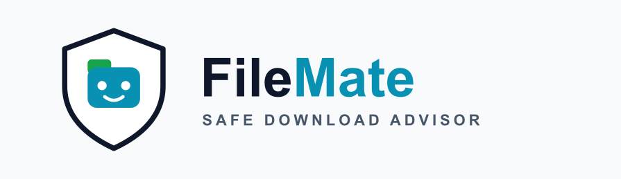

<p align="center">
  <picture>
    <source media="(prefers-color-scheme: dark)" srcset="image/filemate_dark.png">
    
  </picture>
</p>

<p align="center">
  Web edukasi keamanan siber untuk melatih kebiasaan memeriksa file unduhan sebelum dibuka.
</p>

<p align="center">
  
  
  
</p>

## Tentang FileMate

Banyak orang menilai keamanan file hanya dari nama dan ikonnya. Padahal `Kontrak_Magang_2026.pdf.exe` dapat terlihat seperti dokumen PDF biasa ketika sistem operasi menyembunyikan ekstensi aslinya.

FileMate mengajarkan cara mengenali jebakan seperti itu lewat simulasi interaktif dan alat pemeriksa file. Tujuannya bukan menggantikan antivirus, melainkan melatih pengguna menjadi *human firewall* yang teliti.

Proyek ini adalah Mini PBL Semester 1 dari Tim Satgas Salah Download, Kelompok 6 Rekayasa Keamanan Siber (RKS), Politeknik Negeri Batam.

## Fitur

- **Lab simulasi.** Tiga kasus acak dengan tombol X-Ray Inspect, Cek SHA-256, dan petunjuk analis. Setiap file harus diputuskan: buka atau hapus.
- **Pemeriksa file lokal.** Memeriksa *magic bytes* dan ekstensi ganda, lalu memberi status Aman, Perhatian, atau Bahaya. Pemeriksaan berjalan di browser dan isi file tidak diunggah.
- **Cek SHA-256.** Menghitung sidik jari file, mencocokkannya dengan hash resmi, dan membuka hasil pencariannya di VirusTotal.
- **Evaluasi akhir.** Menampilkan skor, kategori risiko, diagnosis kesalahan, dan rincian keputusan.
- **Papan peringkat anonim.** Nama disamarkan sebelum disimpan, misalnya `Rohit` menjadi `R****T`.
- **Panduan praktis.** Langkah verifikasi file untuk Windows, macOS, dan Linux, termasuk prosedur darurat jika terlanjur membuka malware.

## Cara kerja simulasi

Setiap sesi berisi satu kasus dari masing-masing kategori:

| Kategori | Yang diuji |
|----------|------------|
| `SPOOFING` | Mengenali file yang menyamar, misalnya dengan ekstensi ganda atau isi yang berbeda dari ekstensinya |
| `HASH` | Mengenali file yang isinya sudah diubah dengan mencocokkan SHA-256 |
| `FATIGUE` | Tetap teliti saat harus memeriksa banyak file sekaligus |

Skor dimulai dari **100** dan berkurang sesuai keputusan pengguna:

| Tindakan | Penalti |
|----------|---------|
| Membuka file berbahaya | −15 |
| Menghapus file aman | −5 |
| Memakai petunjuk | −5 |

| Skor akhir | Kategori risiko |
|------------|-----------------|
| 81–100 | Rendah |
| 51–80 | Sedang |
| 0–50 | Tinggi |

> [!NOTE]
> Semua file di `data/dummy_files/` adalah file latihan, bukan malware asli.

## Menjalankan proyek

Kebutuhan: **Python 3.10 atau lebih baru** dan Git.

```bash
git clone https://github.com/kaysan220/FileMate-Save_Download_Advisor.git
cd FileMate-Save_Download_Advisor
pip install -r backend/requirements.txt
python app.py
```

Buka <http://127.0.0.1:5000> di browser.

FileMate memiliki dua server yang melayani API untuk frontend yang sama. Jalankan salah satu saja:

| Server | Perintah | Penyimpanan |
|--------|----------|-------------|
| Utama | `python app.py` | CSV |
| Terstruktur | `python backend/wsgi.py` | SQLite |

Data kedua server tidak saling tersinkron. Di Windows, perintah `sha256sum`, `file`, dan `ls -l` diganti otomatis dengan fallback Python.

### Konfigurasi (opsional)

Server dapat berjalan tanpa konfigurasi tambahan. Untuk mengubah pengaturan, salin `.env.example` menjadi `.env`:

| Variabel | Kegunaan |
|----------|----------|
| `SECRET_KEY` | Kunci cookie sesi admin. Jika kosong, dibuat acak setiap server dijalankan |
| `ADMIN_RECOVERY_HASH` | Hash password cadangan admin. Isi lewat `python -m core.atur_password_cadangan` |
| `COOKIE_SECURE` | Isi `1` jika situs diakses lewat HTTPS |
| `PROXY_COUNT` | Jumlah reverse proxy tepercaya. Kosongkan di komputer lokal |
| `SUBMIT_BATAS_PER_IP` | Batas kiriman skor dan masukan per IP (bawaan 5) |
| `SUBMIT_JENDELA_DETIK` | Rentang waktu batas kiriman (bawaan 600 detik) |

Jangan pernah meng-commit file `.env`. Untuk pemasangan di server, lihat [panduan Nginx dan keamanan admin](docs/NGINX_KEAMANAN_ADMIN.md).

## Teknologi

| Lapisan | Teknologi |
|---------|-----------|
| Frontend | HTML, CSS, dan JavaScript tanpa framework |
| Backend | Python, Flask 3 |
| Penyimpanan | CSV atau SQLite |
| Utilitas sistem | `sha256sum`, `file`, `ls -l` |
| Rencana produksi | Nginx, Gunicorn, systemd, Cloudflare |

## Struktur folder

```
├── app.py              Server utama (CSV)
├── core/               Logika server utama, autentikasi admin, utilitas Linux
├── backend/            Server terstruktur (SQLite) dan modul bersama
├── page/               Halaman HTML
├── tampilan/           CSS dan JavaScript
├── image/              Logo
├── data/               Bank skenario, file latihan, dan data hasil
├── tests/              Tes otomatis
└── docs/               Dokumentasi teknis
```

## Pengujian

```bash
python -m unittest discover -s tests -v
```

Tes memakai `unittest` bawaan Python dan folder sementara, sehingga data asli tidak berubah. Beberapa tes hanya berjalan di Linux dan otomatis dilewati di Windows. Untuk uji API manual dan uji keamanan, lihat [TESTING.md](docs/TESTING.md).

## Batasan saat ini

FileMate masih dikembangkan. Hal-hal berikut belum selesai:

- **Penilaian masih di browser.** Server memvalidasi format dan rentang skor, tetapi skor palsu yang masuk akal masih bisa lolos. Alur penilaian di server (`/api/session/*`) sudah tersedia, tetapi belum dipakai frontend.
- **Utilitas Linux dan API admin belum terhubung ke frontend.** Endpoint-nya sudah tersedia di server.
- **Bank skenario belum sinkron.** Server memiliki 10 skenario, sedangkan frontend memakai 4. File latihan untuk skenario baru juga belum dibuat.
- **Sebagian tes belum lulus** karena bank skenario belum sinkron dan `core/linux_utils.py` belum sesuai dengan tes terbarunya.

Daftar celah keamanan yang diketahui ada di [SECURITY.md](docs/SECURITY.md).

## Dokumentasi

| Dokumen | Isi |
|---------|-----|
| [ARCHITECTURE.md](docs/ARCHITECTURE.md) | Komponen, alur data, dan keputusan desain |
| [API_CONTRACT.md](docs/API_CONTRACT.md) | Daftar endpoint beserta format request dan respons |
| [DATA_SCHEMA.md](docs/DATA_SCHEMA.md) | Struktur skenario, CSV, dan tabel SQLite |
| [SECURITY.md](docs/SECURITY.md) | Model ancaman, kontrol keamanan, dan celah yang diketahui |
| [TESTING.md](docs/TESTING.md) | Panduan pengujian |
| [PANDUAN_TIM_BACKEND.md](PANDUAN_TIM_BACKEND.md) | Panduan kerja tim backend |

## Tim

**Tim Satgas Salah Download** — Kelompok 6 RKS, Politeknik Negeri Batam

| Nama | Peran |
|------|-------|
| Muhammad Fardan | Project Leader & UI/UX Designer |
| Muhamad Yazid Firdaus | Linux & Infrastructure Specialist |
| Kaysan Nawfal | Backend & Logic Developer |
| Rohit Al Bukhori | Scenario & Data Handling Developer |
